<div align="center">


<br/>

[](https://github.com/Syed-exe/shiddat-releases/releases/latest)
[](https://github.com/Syed-exe/shiddat-releases/releases)
[](https://shiddat.snapz.dev)
[](https://discord.gg/snap-z-1102558646505836606)

<br/>

[**📥 Download**](#-download) &nbsp;•&nbsp; [**✨ Features**](#-features) &nbsp;•&nbsp; [**📸 Screenshots**](#-screenshots) &nbsp;•&nbsp; [**🛠️ Install**](#️-install-guide) &nbsp;•&nbsp; [**💬 Support**](#-support--community)

<br/>

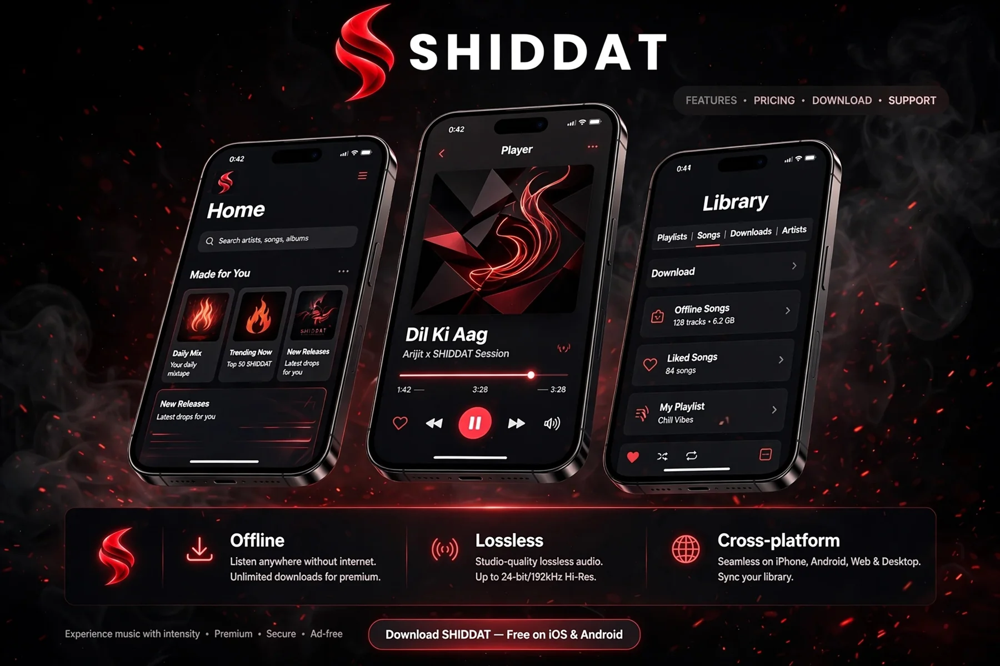

</div>

<br/>

## 📥 Download

<div align="center">
  
</div>

<br/>

| Platform | Package | Get it |
| :-- | :-- | :-- |
| 🤖 **Android** | Signed `.apk` | [**⬇ Download APK**](https://github.com/Syed-exe/shiddat-releases/releases/latest) |
| 🪟 **Windows** | `.exe` / `.msi` / portable `.zip` | [**⬇ Download for Windows**](https://github.com/Syed-exe/shiddat-releases/releases/latest) |
| 🍎 **macOS** | `.dmg` (Apple Silicon & Intel) | [**⬇ Download for macOS**](https://github.com/Syed-exe/shiddat-releases/releases/latest) |
| 🐧 **Linux** | `.AppImage` / `.deb` / `.rpm` | [**⬇ Download for Linux**](https://github.com/Syed-exe/shiddat-releases/releases/latest) |

> [!NOTE]
> Desktop builds come with everything bundled — **no Java or extra setup needed.**
> This repository hosts the official Shiddat release builds.

<br/>

## ✨ Features

<div align="center">
  
</div>

<br/>

<table>
  <tr>
    <td width="50%" valign="top">

### 🎧 Audiophile Playback
- **Lossless & Hi-Res** — FLAC / ALAC up to **24-bit / 192 kHz**
- **Gapless + Crossfade** — adjustable 0–12 s blends
- **Automix** — beat-matched, DJ-style transitions
- **Dolby Atmos & Spatial Audio** support
- **7-band Equalizer** + loudness normalization
- **Skip Silence** & speed control (0.5×–2×)
- **Stats for Nerds** — live codec, bitrate, sample rate & bit depth

    </td>
    <td width="50%" valign="top">

### 🎤 Lyrics That Feel Alive
- **Word-by-word synced lyrics** with glow & blur focus
- Multiple lyrics sources for the best match
- **Lyrics translation** + romanized script support
- Works across languages — **Hindi, Punjabi, Telugu, English** & more

    </td>
  </tr>
  <tr>
    <td width="50%" valign="top">

### 📶 Offline & Library
- **Offline downloads** with artwork & tags
- **Local music** — mix your device files with streaming
- **SMB & WebDAV** — play from your own server or share
- **Import playlists** from **Spotify** & **Apple Music**
- Liked songs, playlists, history, **backup & restore**

    </td>
    <td width="50%" valign="top">

### 👥 Social Listening
- **Listen Together** — party of 2–10 listeners via code or QR
- **Jam Sessions** — vote on the queue in real time
- **Shiddat Blend** — shared taste score + joint playlist
- **Friend Activity** — see what friends are playing live

    </td>
  </tr>
  <tr>
    <td width="50%" valign="top">

### 🔄 Shiddat Connect
- Hand off playback between your devices
- Use your phone as a **remote** for your desktop
- Local Wi-Fi discovery **+ cloud relay** across networks

    </td>
    <td width="50%" valign="top">

### 🎨 Design & Integrations
- **Artwork-driven dynamic colors** & fluid gradients
- **Liquid-glass** floating nav bar
- **Animated cover art** & full-screen covers
- **Discord Rich Presence** & **Last.fm / ListenBrainz** scrobbling
- **Home-screen widgets** & **Android Auto**
- **Replay** — your top songs, artists & genres
- **15+ app languages**

    </td>
  </tr>
</table>

<br/>

<div align="center">
  
</div>

<br/>

## 📸 Screenshots

<table>
  <tr>
    <td align="center" width="25%">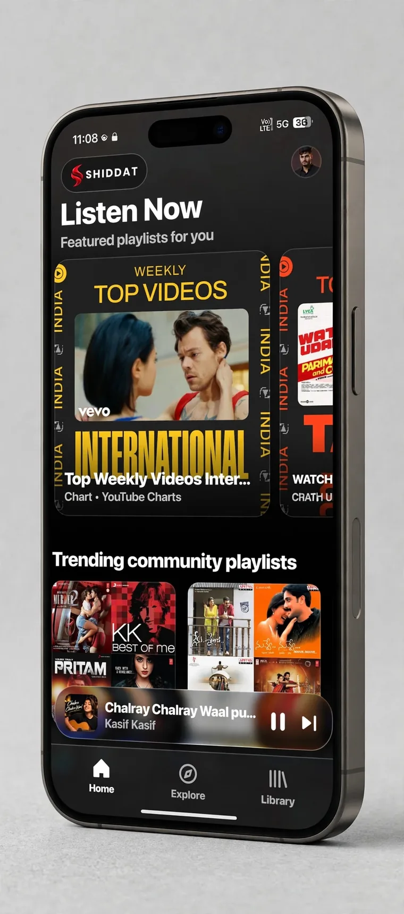<br/><sub><b>🏠 Listen Now</b></sub></td>
    <td align="center" width="25%">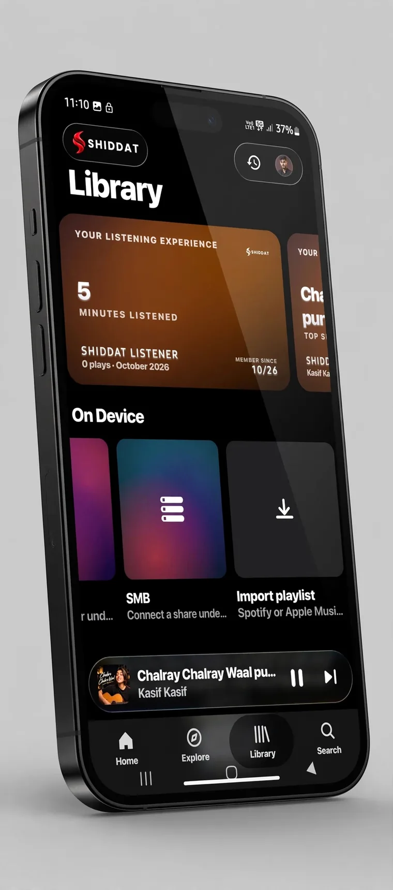<br/><sub><b>📚 Library</b></sub></td>
    <td align="center" width="25%">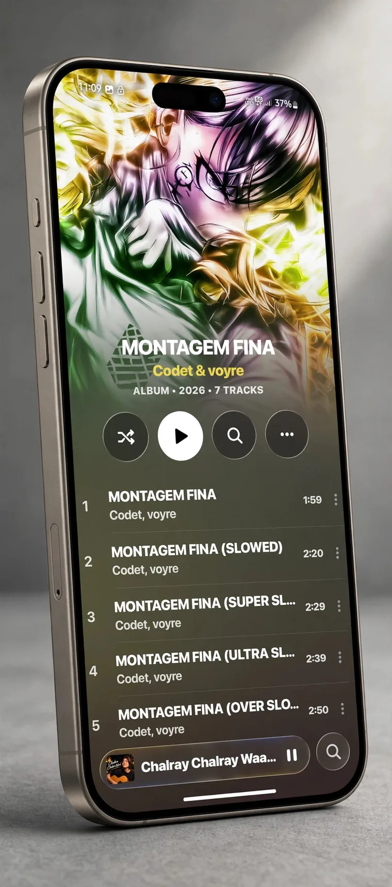<br/><sub><b>💿 Album View</b></sub></td>
    <td align="center" width="25%">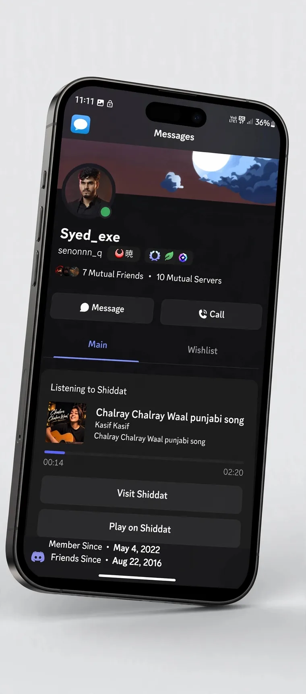<br/><sub><b>🎮 Discord Presence</b></sub></td>
  </tr>
</table>

### 🔁 Replay — Your Year in Sound, Relived

<div align="center">
  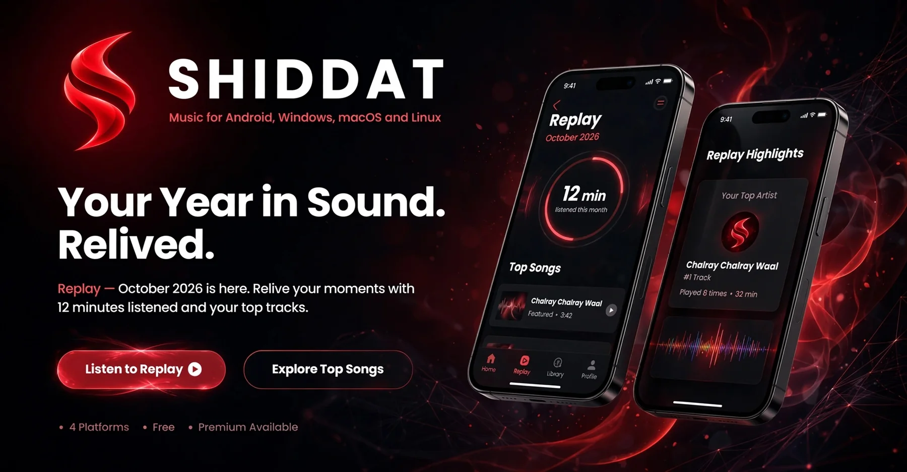
</div>

<br/>

## 🛠️ Install Guide

<details>
<summary><b>🤖 Android</b></summary>

1. Download the latest `.apk` from [Releases](https://github.com/Syed-exe/shiddat-releases/releases/latest).
2. Open it and allow **Install from this source** when asked.
3. Tap **Install** → open Shiddat → enjoy. 🎶

</details>

<details>
<summary><b>🪟 Windows</b></summary>

1. Download the `.exe` or `.msi` installer (or the portable `.zip`).
2. Run it and follow the steps.
3. If SmartScreen warns you, click **More info → Run anyway**.

</details>

<details>
<summary><b>🍎 macOS</b></summary>

1. Download the `.dmg` for your Mac (**Apple Silicon** or **Intel**).
2. Drag **Shiddat** into **Applications**.
3. If macOS says the developer is unidentified, run:
   ```bash
   xattr -cr /Applications/Shiddat.app
   ```

</details>

<details>
<summary><b>🐧 Linux</b></summary>

```bash
# AppImage
chmod +x Shiddat-*.AppImage && ./Shiddat-*.AppImage

# Debian / Ubuntu
sudo dpkg -i shiddat_*.deb

# Fedora / RHEL
sudo rpm -i shiddat-*.rpm
```

</details>

<br/>

## 💬 Support & Community

<div align="center">
  
</div>

<br/>

<div align="center">

[](https://shiddat.snapz.dev)
[](https://discord.gg/snap-z-1102558646505836606)
[](https://github.com/Syed-exe/shiddat-releases/issues)
[](https://github.com/Syed-exe/shiddat-releases/releases)

</div>

<br/>

## ⚖️ Disclaimer

Shiddat is an independent music app and is **not affiliated with or endorsed by** Google, YouTube, Spotify, Apple, Last.fm or Discord. All trademarks belong to their respective owners.

---

<div align="center">

**🔥 SHIDDAT — Music with intensity.**

Made with ❤️ by [**Syed_exe**](https://github.com/Syed-exe) • [shiddat.snapz.dev](https://shiddat.snapz.dev)

<a href="#top"><b>▲ BACK TO TOP</b></a>

</div>
